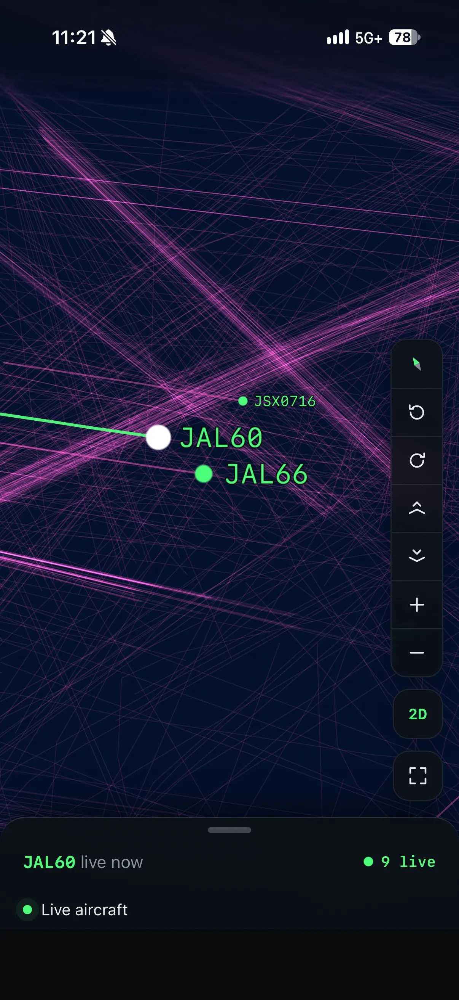
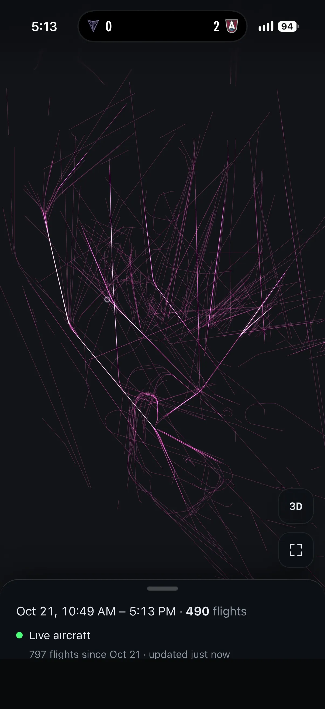

I used a raspberry pi and RTL-SDR to capture ADSB data from my home and while out and about to build a picture of aviation activity around me. 

The application also features several declutter algorithms and tools to show different datasets depending on 

- Route commonality
- Altitude
- Date/time
- Velocity

