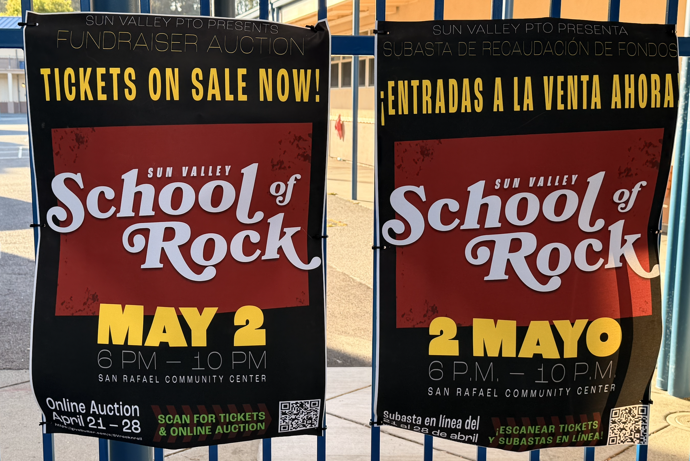
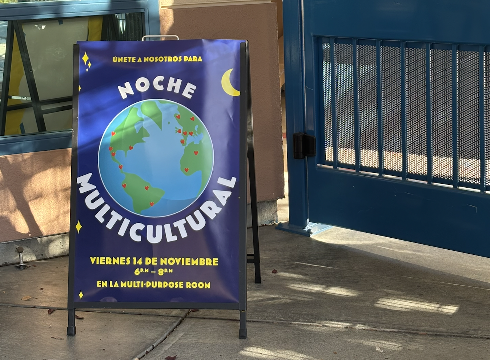

When my daughter entered the local elementary school, I volunteered in the art class every Wednesday morning, unless I was deathly ill. It was an amazing volunteering opportunity as the teacher at the time wanted me to be involved in teaching and supporting students, not just at the back filling paint bottles. 

Since then, my schedule hasn't aligned with either of my kids' art classes, so I've been lending a hand to the parent-teacher organization on their graphic design needs. 

For every poster, I include a black-and-white, coloring book style version for sending him in Friday Folders. This is fun for the kids, and also means the reminder will more likely stay out and in-view, so parents remember what's coming! up!

