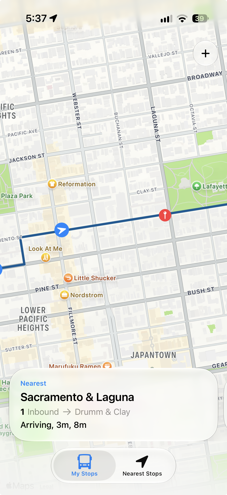

---
# Every field, for reference. Copy this file to start a new post; the file
# name becomes the URL, so my-new-post.md is published at /blog/my-new-post.
title: How to write a post
date: 2026-11-05
summary: A reference post that shows every field and every bit of formatting the blog supports. It's a draft, so it only appears when you run the site locally.
# Optional. The text the share page starts with; falls back to the title.
share: A quick tour of how posts work on my site.
# Optional cover image, relative to this file. It's also the image on share cards.
# cover: ./example-post/cover.jpg
# coverAlt: What the cover shows
# Drafts show up in `npm run dev` with a Draft label, and are left out of the
# built site, the RSS feed and the sitemap. Delete this line (or set it to false) to publish.
draft: true
---

Posts are plain Markdown. Write a paragraph like this one, leave a blank line, and start the next. **Bold** and *italic* work as you'd expect, and so do [links](https://www.holtawaydesign.com).

## A section heading

Use `##` for sections and `###` for the smaller headings inside them. The post's title comes from the `title` field above, so don't repeat it here.

### Lists

- Bulleted lists start with a dash
- Each item on its own line
- Numbered lists start with `1.`

1. First
2. Second

### Quotes

> Pull quotes and quotations start with a greater-than sign. They're set larger, with an accent rule.

### Images

Put images in a folder next to the post (for example `src/content/blog/my-post/`) and link to them with a relative path. They're resized and converted to WebP automatically.



### Code

Inline code looks like `npm run dev`. Blocks get syntax highlighting:

```ts
const greeting = 'Hello';
console.log(`${greeting}, world`);
```

---

A horizontal rule (three dashes) separates sections when a heading would be too much.
