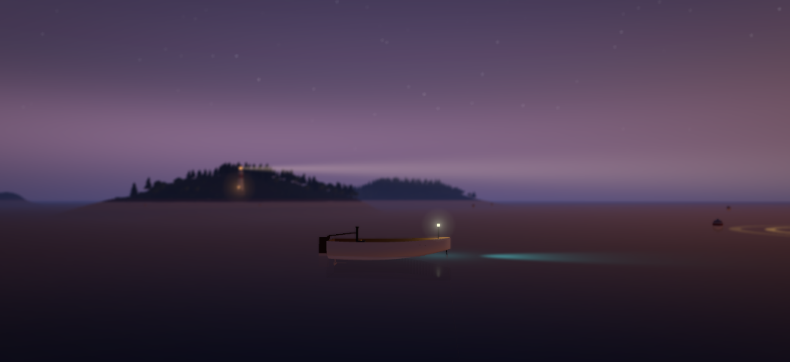
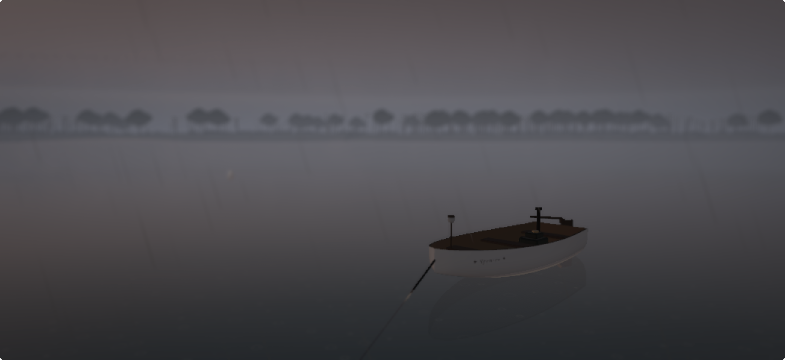

Throughout my adult life, I've been excited by the experiential opportunities presented by new technologies and form factors.

The iPhone Duo was announced this year and its "tent posture" got me started thinking about how an application could live and run full-time. I was certain the productivity world was already all over it: to-do lists, pomodoro timers, e-mail updates, slack, you name it.

So I considered something else: instead of adding to the stress, what if the Duo became a window into another world you could dive into from time to time. 

This became Fishing for Compliments: a game-but-not-a-game in which you navigate different island biomes, paying attention to what is around you to help you find affirming messages in bottles, HealthKit reflection pools and some day (if it ever gets approved) cargo ships with positive messages to take into your day. 

Leaving  your boat anchored for 15 seconds make the app enter Relax or Photo Mode. A slowly rotating, live action screensaver that continues to play the calming music and sound effects of the game: useful for relaxation or blocking the sounds from around you in your office at home. 

It's truly a duality, like the Duo: a window and a world you can immerse yourself in. 

***

It all started in 2006 at Central Saint Martins where I was studying graphic design. I learned about MIT's multitouch display experiments and, as a life-long aviation nerd, immediately started concepting a multi-touch in-cockpit display that would allow pilots to view their aircraft in 3D space, in clear skies, during the day, whatever the real conditions were. While my instructors maybe didn't quite understand my pivot from graphic design into futuristic interfaces for the aviation industry, I've never been prouder that years later, while training for my own PPL, the [ForeFlight](https://foreflight.com) app was developing quickly, and was something I used in the cockpit.
