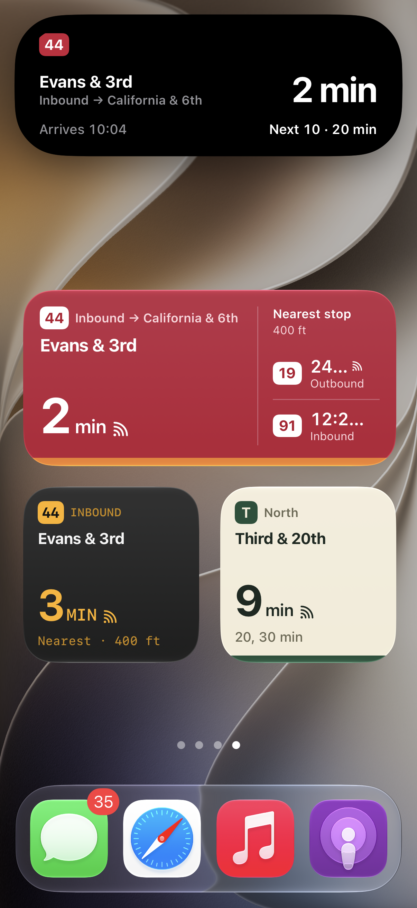
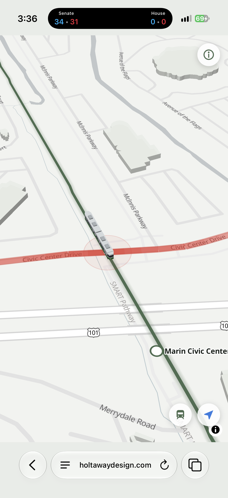

It's one of the most common pieces of feedback I get on anything I build that has a map, transit or navigation component. 

So Google Maps can do it, but how well?

Is it tailored to you or to every possible map user in the world? 

Is the personalization there to make the experience better for you, or for you and advertisers?

Is it designed primarily for drivers, walkers or transit riders?

I still believe in simple apps that do one thing well - which is why I made [My Bus SF](https://apps.apple.com/us/app/mybussf-2026/id6814334469): a bus app for San Francisco commuters who take the same buses from the same stops each work day. The 2026 version (updated from the 2014 version) brings widgets and live activities to the experience, meaning you don't even have to open the app once it's set up. In my opinion, that's better than the 3-5 taps it takes to get what I need in Google Maps.

On the side, I also made [Don't Get SMART Trained](www.holtawaydesign.com/smart), to help drivers get around the SMART Train traffic  in San Rafael, where I live. My personal solution is to take a deep breath but I saw plenty of negative sentiment about the level crossings on Nextdoor and thought it might help my neighbors.
