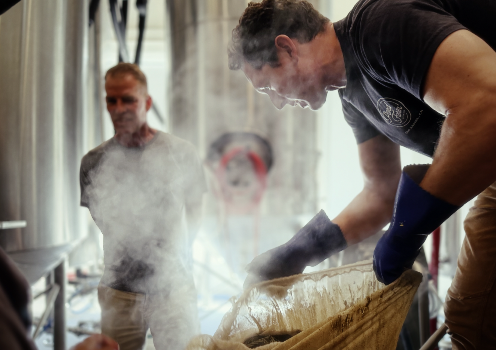

Part of freelancing as a designer means going back to print from time to time. 

As a member of Pond Farm Brewing's Stein Society, I took part in a beer creation activity that included beer style, naming and labeling. My team didn't win the vote but as I worked with Pond Farm on their website I was asked if I could bring the winning team's sketches to life as a real label for the beer. 

Of course I said yes. I also took the opportunity to learn Affinity design instead of using illustrator and learned a lot in the process. 

