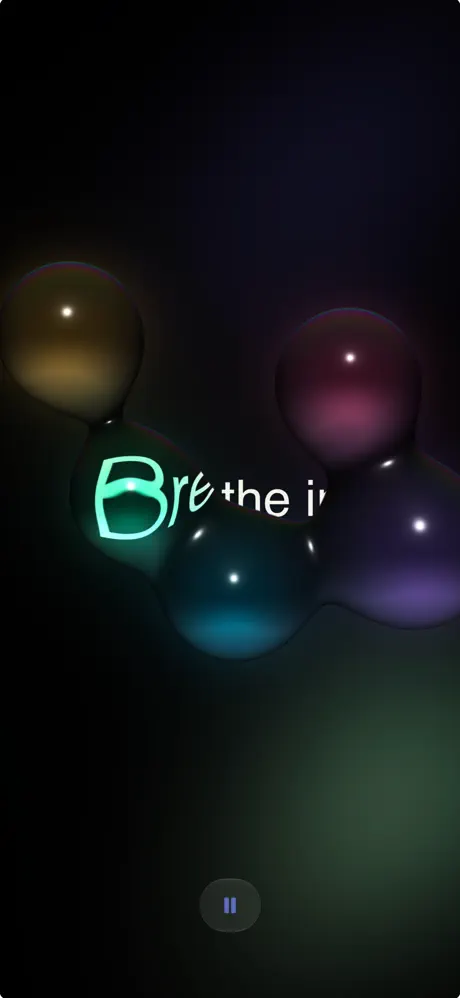
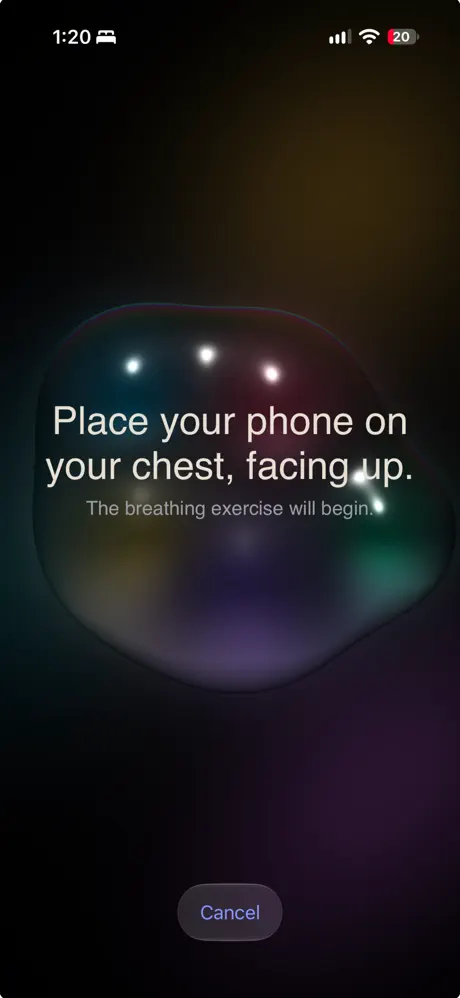
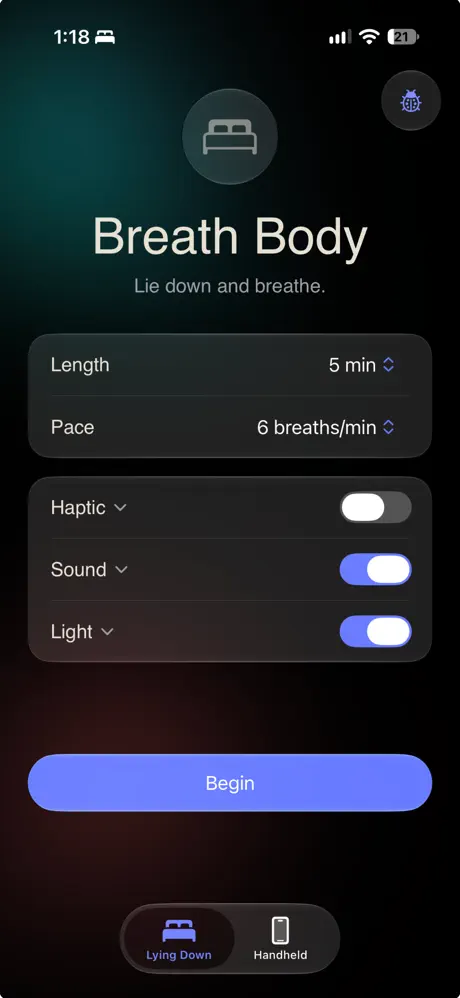

[Breath Body on the App Store](https://apps.apple.com/us/app/breath-body/id6819162493)

The honest truth is: it was pretty unintentional but as soon as the idea entered my head, the ideas kept coming.

During my 4 years at Calm, my life was turned upside down by the pandemic, a second child born during the August 2020 fire season, followed by separation and finally, job loss. 

Working at Calm made it easy to lean on breath work as a stress and anxiety solution, but something I found was a particular way I meditated. I prefer to lie down, and I prefer to do it for 10 minutes. I grew frustrated that lying down meant I couldn't look at the screen which many breath work apps require for pacing, and when I used the Apple Watch breathing tool, I was limited to 5 minutes.

***

## Different ways to breathe

I had been working on two apps that used Metal for GPU processing and I wanted to create something less on rails [(train pun not intended)](https://www.holtawaydesign.com/olivers-train) and more organic and responsive to the user and their needs.

I had a quick vision flash in my mind. Something you could stare at (if you wanted), feel (if you wanted) and hear (if you wanted) to guide your breath work. An immersive experience that lets you breathe sitting up, lying down, or walking around. Eyes closed, or eyes open. However you want, as intentionally or loosely as you want. 

**Breath guidance features include:**

- Growing, shrinking, merging and separating balls of liquid that respond to touch and phone tilt
- Ocean sounds timed to the breaths
- Haptic waves timed to the breaths
- A glow mode for when the phone is on your chest facing up, timed to the breaths.
